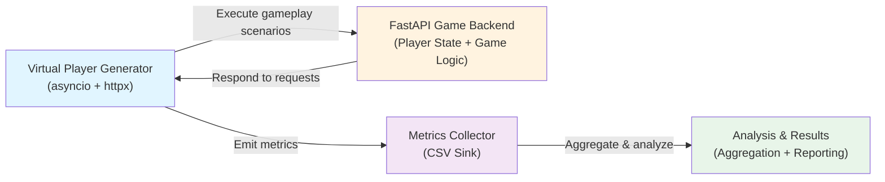

# Game Server Load Testing & Traffic Simulation Framework

## Short Description

A Python-based experimental framework for simulating multiplayer-game backend traffic and evaluating system performance under increasing concurrent-player workloads. This project generates synthetic player populations executing realistic gameplay lifecycle scenarios against a FastAPI mock game backend, collecting detailed performance metrics across multiple load profiles.

## Problem Statement

Multiplayer game backends must handle unpredictable spikes in concurrent players while maintaining acceptable latency and reliability. Understanding how a server responds to varying loads—from baseline user populations to stress scenarios—is critical for capacity planning, identifying bottlenecks, and validating performance assumptions.

This framework enables systematic, reproducible performance testing by:
- Simulating realistic concurrent player behavior
- Executing controlled load sweeps across multiple concurrency levels
- Collecting fine-grained performance metrics (latency percentiles, error rates, throughput)
- Distinguishing between system-under-test failures and load-generation artifacts

## Goals

1. **Reproduce realistic gameplay**: Simulate the natural player lifecycle (login, profile, matchmaking, gameplay, disconnect)
2. **Measure server performance**: Collect latency, throughput, and success rates under controlled loads
3. **Identify system bottlenecks**: Detect performance degradation points as concurrency increases
4. **Enable reproducible testing**: Provide automated, configurable load sweeps for regression testing
5. **Distinguish layer failures**: Clarify whether performance issues originate from the server or the load-generation layer

## Architecture



## How It Works

1. **Load Generator** (`load_tester/`):
   - Spawns N concurrent virtual players using Python `asyncio`
   - Each player executes a gameplay lifecycle (login → profile → matchmaking → game start → actions → game end)
   - Uses `httpx.AsyncClient` to send HTTP requests to the backend
   - Records request timing, success/failure, and status codes

2. **Game Backend** (`server/`):
   - FastAPI application providing RESTful endpoints for player actions
   - Maintains in-memory player state and game session state
   - Simulates game logic (e.g., matchmaking delay, action processing)
   - No persistence layer; state is ephemeral per run

3. **Metrics Collection** (`load_tester/metrics.py`):
   - Records per-request: endpoint, latency, status code, timestamp
   - Aggregates: request counts, success rates, error rates, percentile latencies, throughput

4. **Analysis** (`analysis/`):
   - Loads CSV results
   - Computes summary statistics
   - Generates reports and visualizations

## Gameplay Simulation

Each virtual player follows a simplified multiplayer-game lifecycle:

```
┌─────────┐      ┌─────────┐      ┌──────────────┐      ┌───────────┐
│  Login  │──→  │ Get Prfl │──→  │  Matchmake   │──→  │Game Start │
└─────────┘      └─────────┘      └──────────────┘      └───────────┘
                                                                │
                                                                ↓
                                                        ┌──────────────┐
                                                        │Player Actions│
                                                        │(repeated)    │
                                                        └──────────────┘
                                                                │
                                                                ↓
                                                        ┌───────────────┐
                                                        │  Game End     │
                                                        │ + Disconnect  │
                                                        └───────────────┘
```

Actions within a game include:
- Player movements or game-specific events
- Simulated delay between actions to represent user think-time
- Optional mid-game reconnection scenarios

## Load Testing Methodology

The framework executes three experiment categories:

### Baseline (Low Concurrency)
Tests typical user loads:
- 10 concurrent players
- 50 concurrent players
- 100 concurrent players

### Peak (Medium-High Concurrency)
Tests moderate load spikes:
- 100 concurrent players
- 250 concurrent players
- 500 concurrent players
- 1000 concurrent players

### Stress (High Concurrency)
Tests extreme scenarios:
- 1000 concurrent players
- 1500 concurrent players
- 2000 concurrent players
- 3000 concurrent players

Each experiment:
- Runs virtual players concurrently for a fixed duration
- Records request-level metrics (latency, status, endpoint)
- Produces a CSV file with aggregated results
- Outputs summary statistics (RPS, success rate, percentile latencies)

## Metrics

Per-test aggregations include:

| Metric | Description |
|--------|-------------|
| **Total Requests** | Count of all HTTP requests sent |
| **Successful Requests** | Requests with HTTP 2xx status |
| **Failed Requests** | Requests with non-2xx status or connection errors |
| **Success Rate** | Percentage of requests that succeeded |
| **Error Rate** | Percentage of requests that failed |
| **Requests/Second (RPS)** | Throughput: total requests / test duration |
| **Mean Latency** | Average request latency (ms) |
| **P50 Latency** | 50th percentile latency (ms) |
| **P95 Latency** | 95th percentile latency (ms) |
| **P99 Latency** | 99th percentile latency (ms) |
| **Endpoint-Level Performance** | Per-endpoint request counts, success rates, latencies |

## Project Structure

```
game-server-load-tester/
├── server/                          # FastAPI mock backend
│   ├── __init__.py
│   ├── main.py                      # FastAPI app, endpoint definitions
│   ├── models.py                    # Pydantic request/response schemas
│   └── state.py                     # In-memory player/game state
├── load_tester/                     # Concurrent load generator
│   ├── __init__.py
│   ├── player.py                    # Virtual player class, lifecycle logic
│   ├── scenarios.py                 # Gameplay scenario definitions
│   ├── runner.py                    # Orchestrates concurrent players
│   ├── metrics.py                   # Metrics collection and aggregation
│   └── config.py                    # Load-tester configuration
├── analysis/                        # Post-test analysis and reporting
│   ├── __init__.py
│   └── analyze.py                   # CSV aggregation, statistics
├── scripts/                         # Automated test execution
│   ├── run_tests.py                 # Single load test runner
│   └── run_load_sweep.py            # Multi-scenario sweep orchestrator
├── results/                         # CSV outputs (baseline/, peak/, stress/)
├── config.yaml                      # Global configuration (timeouts, endpoints, etc.)
├── requirements.txt                 # Python dependencies
└── README.md                        # This file
```

## Technology Stack

| Component | Technology |
|-----------|-----------|
| Backend | FastAPI 0.100+, Uvicorn |
| Load Generation | Python 3.9+, asyncio, httpx |
| Metrics | CSV (pandas for analysis) |
| Configuration | YAML |

## Installation

### Prerequisites

- Python 3.9 or later
- pip (Python package manager)

### Setup

1. Clone or download the repository:
   ```bash
   git clone <repository-url>
   cd game-server-load-tester
   ```

2. Install dependencies:
   ```bash
   pip install -r requirements.txt
   ```

3. (Optional) Review configuration:
   ```bash
   cat config.yaml
   ```

## Running the Server

Start the FastAPI backend:

```bash
uvicorn server.main:app --reload
```

The server will start on `http://localhost:8000` by default.

**Endpoints** (example):
- `POST /api/login` - Player login
- `GET /api/profile/{player_id}` - Get player profile
- `POST /api/matchmake` - Find a match
- `POST /api/game/start` - Start a game
- `POST /api/game/action` - Execute in-game action
- `POST /api/disconnect` - Disconnect player

## Running a Single Load Test

Execute a single load test with a specified number of concurrent players:

```bash
python scripts/run_tests.py
```

By default, this runs a test with the concurrency level defined in `config.yaml`. Results are saved to `results/` as a CSV file.

## Running the Full Load Sweep

Execute all three experiment categories (baseline, peak, stress) automatically:

```bash
python scripts/run_load_sweep.py
```

This will:
1. Run all baseline experiments (10, 50, 100 players)
2. Run all peak experiments (100, 250, 500, 1000 players)
3. Run all stress experiments (1000, 1500, 2000, 3000 players)
4. Save results to `results/baseline/`, `results/peak/`, `results/stress/`
5. Output a summary report

The sweep typically takes 20–30 minutes depending on hardware and configuration.

## Results

### Observed Load-Sweep Performance

#### Baseline (Low Concurrency)

| Players | Total Requests | RPS | Duration (s) |
|---------|----------------|-----|--------------|
| 10      | 146            | 30.34 | 4.81 |
| 50      | 716            | 104.15 | 6.88 |
| 100     | 1473           | 160.60 | 9.17 |

#### Peak (Medium-High Concurrency)

| Players | Total Requests | RPS | Duration (s) |
|---------|----------------|-----|--------------|
| 100     | 1408           | 153.51 | 9.17 |
| 250     | 3800           | 188.23 | 20.19 |
| 500     | 7451           | 181.59 | 41.03 |
| 1000    | 1000           | 46.08 | 21.70 |

#### Stress (High Concurrency)

| Players | Total Requests | RPS | Duration (s) |
|---------|----------------|-----|--------------|
| 1000    | 1000           | 51.78 | 19.31 |
| 1500    | 1500           | 55.01 | 27.27 |
| 2000    | 2000           | 56.69 | 35.28 |
| 3000    | 3000           | 34.50 | 86.95 |

### Interpretation

**Baseline & Peak (up to 500 players)**: As concurrency increases from 10 to 500 players, throughput scales roughly linearly (30–188 RPS), indicating the server handles these loads successfully. Each player initiates approximately 14–16 requests during the gameplay lifecycle.

**Peak & Stress (1000+ players)**: At 1000+ concurrent players, the request count becomes approximately equal to the number of players (1000 players → ~1000 requests, 1500 players → ~1500 requests, etc.), representing only **~1 request per player**. This is a stark departure from the 14–16 requests per player observed at lower loads.

### Critical Limitation

**This does NOT indicate that the server fails at 1000+ players.**

Instead, the anomalous request counts at high concurrency suggest that **the virtual-player gameplay lifecycle is not completing** at these load levels. Possible causes include:

1. **Load-generation layer bottleneck**: The virtual players may be failing to execute beyond the initial login or early-stage requests
2. **Connection pool exhaustion**: Without a shared `httpx.AsyncClient` across players, connection overhead or resource contention may prevent players from progressing through their lifecycle
3. **Visibility gap**: Unhandled exceptions or retries within the load generator may be silently failing without clear error reporting

**Key observation**: The request-per-player ratio (14–16 at low load → ~1 at high load) is the diagnostic signal that the load-generation layer, not the server, is the constraint.

## Current Limitations

1. **Load-Generator Scalability**: The framework does not reliably generate high-concurrency workloads. At 1000+ players, the virtual-player lifecycle stalls, resulting in incomplete scenarios and confounded results.

2. **Shared Client**: Virtual players currently do not share an `httpx.AsyncClient` connection pool. Each player may be creating its own client, leading to excessive overhead and connection contention.

3. **Error Visibility**: Exceptions and failures within the load generator are not comprehensively logged. Failed player lifecycle events are not clearly distinguished from server-side failures.

4. **State Validation**: There is no post-test validation that confirms the expected player progression (e.g., "Did the player reach the game-start endpoint?").

5. **Server Persistence**: The backend uses in-memory state; there is no durable storage or recovery mechanism.

## Future Improvements

### High Priority

- **Refactor virtual-player concurrency**: Implement a shared `httpx.AsyncClient` across all virtual players to reduce connection overhead and improve scalability
- **Enhanced error logging**: Capture and report detailed exception information for each failed player lifecycle event
- **Metrics per-player-state**: Track how many players reach each stage of the lifecycle (login → profile → matchmaking → game start → actions → end)
- **Timeout and retry tuning**: Experiment with asyncio timeouts and retry strategies to improve high-concurrency stability

### Medium Priority

- **Latency percentiles by stage**: Break down P95/P99 latencies by gameplay stage (login latency vs. in-game action latency)
- **Configurable think-time**: Allow variable player think-time (idle time between actions) to simulate realistic user behavior
- **Reconnection scenarios**: Implement and measure player reconnection under load
- **Cluster simulation**: Extend the backend to simulate multi-server deployments with load balancing

### Lower Priority

- **Server-side persistence**: Add optional database backend for durable player/game state
- **Visualization dashboards**: Real-time or post-hoc UI for results inspection
- **Comparative analysis**: Automated regression detection (e.g., "performance decreased by >5%")
- **Payload variation**: Randomize request payloads and body sizes to simulate realistic game traffic

## Contributing

For bug reports or improvements, please open an issue or pull request.

## License

[Specify your license here, e.g., MIT, Apache 2.0, etc.]
